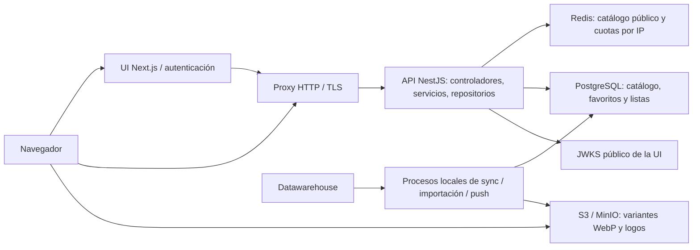

# Arquitectura y capacidad: objetivo de 250 usuarios simultáneos

Fecha de revisión: 2026-09-16. Alcance: este repositorio de API. No se inspeccionaron el código de la UI, su login, ni la configuración del servidor desplegado.

## Dictamen

El monolito modular es una base apropiada para este objetivo. El riesgo inmediato está en las consultas, la multiplicación de trabajo al vencer la caché y los límites de recursos. Dividir servicios no resuelve por sí solo esos problemas.

**250 usuarios conectados no significa 250 solicitudes por segundo.** Para dimensionar se necesita la frecuencia de acciones y cuántas llamadas genera la UI por acción. Por ejemplo: 250 usuarios con una acción cada 5 segundos y 3 llamadas por acción generan aproximadamente 150 solicitudes/s. Las descargas de imágenes se cuentan aparte.

Se asume uso mixto mientras se obtiene el patrón real. La aceptación propuesta es menos de 1% de errores, p95 inferior a 1s y p99 inferior a 2s durante carga mixta. p95 significa que el 95% de las respuestas termina antes de ese tiempo. Estos son objetivos de ingeniería, no un SLA acordado.

## Mapa del sistema



La API verifica JWT asimétricos; `jose` reutiliza las claves públicas descargadas. Las consultas del catálogo no necesitan el DWH. Las imágenes tienen URLs públicas y variantes; el navegador descarga sus bytes desde almacenamiento, sin atravesar los controladores de productos.

## Hallazgos y cambios

| Prioridad | Hallazgo | Resultado en el repositorio |
| --- | --- | --- |
| Alta | 250 fallos de caché de la misma URL podían repetir 250 consultas | `CacheService.wrap` comparte el trabajo en curso por clave y proceso; el interceptor HTTP lo utiliza |
| Alta | Redis podía acumular comandos durante una desconexión | Cola offline desactivada, comandos limitados a 500ms, conexión a 1s, sin reintentos por petición y agrupación automática de comandos |
| Alta | Pool de PostgreSQL dependía de valores implícitos y podía esperar indefinidamente | 20 conexiones por proceso, espera de adquisición/conexión de 2s y límite SQL de 5s, configurables |
| Alta | Cargar relaciones requería viajes adicionales a PostgreSQL | `relationJoins` habilitado en Prisma para resolver las relaciones mediante JOIN; verificar esta funcionalidad al actualizar Prisma |
| Alta | Lecturas de páginas y conteos retenían una conexión dentro de transacciones | Consultas independientes en paralelo, liberando antes las conexiones. Los conteos y páginas siguen sin ser una instantánea atómica frente a escrituras concurrentes |
| Alta | Búsquedas `contains`/`ILIKE` sin índices de trigramas | Migración con `pg_trgm`, GIN para nombre/SKU/marca e índices compuestos para filtros y orden |
| Alta | Comprobar y crear listas eran operaciones separadas | Espera local por usuario fuera del pool, más bloqueo transaccional por usuario en PostgreSQL; comprobación e inserción en la misma transacción |
| Alta | Upsert de líneas con lectura anidada podía perder el upsert nativo | Escritura sin `include`, seguida de lectura de relaciones dentro de la transacción |
| Alta | El proxy podía hacer que todos los clientes consumieran una sola cuota | `TRUST_PROXY` permite configurar las IPs/CIDR confiables; necesita la topología real |
| Media | No había límite de solicitudes HTTP abiertas | Admisión de 500 por proceso; el exceso recibe 503 y `Retry-After: 1` |
| Media | Health general consultaba también DWH/S3 y siempre devolvía 200 | Nuevas sondas `/health/live` y `/health/ready`; esta última devuelve 503 sin PostgreSQL o Redis y comparte las comprobaciones |
| Media | Todas las entradas podían vencer juntas | TTL real entre 90% y 100% del TTL declarado; invalidación con SCAN + UNLINK |
| Media | Respuestas privadas sin política HTTP explícita | GET de favoritos y listas devuelve `Cache-Control: private, no-store` |
| Media | Compose podía heredar desarrollo, puerto incorrecto y cron de sincronización | API fijada a modo producción, puerto interno 8080, cron deshabilitado, healthcheck, init, apagado con 30s de margen y rotación de logs (3 archivos de 10MiB) |

## Reglas de caché y consistencia

- Solo catálogo público: productos, proveedores y marcas. Las respuestas privadas van a PostgreSQL, sin compartir resultados entre identidades.
- Para productos con TTL declarado de 300s, la expiración se distribuye entre 270 y 300s. Otros controladores conservan su TTL propio. `REDIS_DEFAULT_TTL` no reemplaza los TTL explícitos de los controladores.
- La agrupación de consultas es **local a cada proceso**. Con dos réplicas pueden ejecutarse dos consultas iguales durante un fallo simultáneo de caché. Redis comparte los resultados entre réplicas; no se introduce un bloqueo distribuido para todas las lecturas.
- La invalidación local evita que una consulta anterior en curso repueble la caché después de invalidarse. Entre procesos, SCAN no es una barrera transaccional: puede sobrevivir un resultado antiguo hasta su TTL. El push remoto también conserva esa ventana. Si el negocio requiere publicación instantánea, implementar versiones del catálogo coordinadas con el push.
- Redis es recuperable desde PostgreSQL. Si falla, los controladores pueden consultar la BD; readiness devuelve 503 para que un balanceador pueda retirar la instancia. Docker Compose marca `unhealthy`, pero no retira tráfico ni reinicia por ese estado automáticamente.
- Redis queda limitado a 256MiB de datos con `allkeys-lfu`. Se necesita memoria adicional para el proceso y AOF. **Este Redis se destina a caché/cuotas**, no a sesiones persistentes. La evicción puede reiniciar una cuota: usar también protección en el proxy si se necesita un límite estricto.
- El limitador por IP sigue permitiendo tráfico si Redis falla; el límite HTTP local continúa activo. No equivale a una protección distribuida contra abuso.

## Configuración de partida

Los valores están en [.env.example](../.env.example). Aplicarlos también en el proveedor de despliegue: editar el ejemplo no cambia un servicio ya desplegado.

| Variable | Valor inicial | Interpretación |
| --- | --- | --- |
| `NODE_ENV` | `production` | Ejecución sin Swagger de desarrollo |
| `DATABASE_POOL_MAX` | `20` | Conexiones máximas por proceso; valor elegido tras comparar 10 y 20 |
| `DATABASE_CONNECTION_TIMEOUT` | `2000` | Milisegundos para obtener conexión |
| `DATABASE_IDLE_TIMEOUT` | `30000` | Cierre de conexiones inactivas |
| `DATABASE_STATEMENT_TIMEOUT` | `5000` | Límite por sentencia en PostgreSQL |
| `REDIS_CONNECT_TIMEOUT` | `1000` | Espera de conexión a Redis |
| `REDIS_COMMAND_TIMEOUT` | `500` | Espera por comando Redis |
| `HTTP_MAX_INFLIGHT` | `500` | Solicitudes HTTP abiertas por proceso |
| `TRUST_PROXY` | vacío inicialmente | IPs/CIDR del proxy real, separados por coma |
| `SYNC_PRODUCTS_ENABLED` | `false` en API desplegada | Evita trabajo de sincronización durante tráfico |

No asignar 250 conexiones a PostgreSQL por tener 250 usuarios. Presupuestar `réplicas × pool + pool de la UI + jobs + administración`, incluyendo réplicas adicionales durante un despliegue, por debajo de `max_connections`. No subir el pool sin comprobar CPU, latencia y cola de conexiones.

`TRUST_PROXY` debe reflejar la red conocida. El proxy debe reemplazar encabezados reenviados y el acceso directo al backend debe estar restringido. Configurar cualquier origen como confiable permite falsear la IP. Incluso con proxy correcto, los clientes detrás del mismo NAT comparten cuota; determinar si se requiere cuota por usuario autenticado en el gateway/UI. La API mantiene 100 solicitudes/minuto/IP por defecto.

Los límites HTTP de 15s para recibir la petición y 10s para recibir encabezados **no cancelan el trabajo del controlador**. El límite SQL y la espera del pool acotan el trabajo de BD; las transacciones interactivas tienen límite de 10s. Ajustar tiempos de jobs en su entorno separado si necesitan más tiempo.

## Pruebas reproducibles

Requisitos: dependencias instaladas y Docker en ejecución. Por defecto el laboratorio construye y ejecuta el Dockerfile real: API con límite de 2 CPU/1GiB, PostgreSQL con 2 CPU/1GiB y Redis con 1 CPU/512MiB. PostgreSQL usa un volumen y Redis AOF. Los volúmenes del laboratorio se eliminan al terminar. Utiliza puertos 15435, 16380, 18080 y 18081. No inicia el `compose.yaml` normal ni utiliza sus volúmenes o credenciales.

```powershell
pnpm.cmd db:generate
pnpm.cmd build
pnpm.cmd test --runInBand
pnpm.cmd test:capacity

# Ensayo prolongado que atraviesa la expiración del catálogo:
$env:CAPACITY_SECONDS = '360'
pnpm.cmd test:capacity
```

`db:generate` requiere que `DATABASE_URL` esté definida, aunque no conecta a ella. En equipos sin `.env`, se puede usar una URL ficticia solo para generar y compilar. El laboratorio define sus propias conexiones internamente.

El ensayo crea PostgreSQL y Redis desechables, aplica **todas las migraciones**, inserta 20.000 productos/40 marcas/20 proveedores y referencias de imágenes, emite JWT de prueba para 250 identidades y ejecuta:

1. 20 creaciones simultáneas de listas del mismo usuario: exactamente 10 altas y 10 conflictos.
2. 25 upserts sobre la misma línea; altas idempotentes de favoritos; lectura cruzada de usuarios rechazada.
3. Ráfagas de 250 solicitudes con caché fría y caliente.
4. Carga mixta con pausas de 1–1,5s por usuario: 60% catálogo, 20% favoritos y 20% listas, incluyendo escrituras. Alterna búsqueda por nombre, búsqueda general por prefijo de nombre y SKU exacto.
5. Parada de Redis: liveness 200, readiness 503 y lectura pública concurrente; posterior recuperación.

Genera `reports/capacity.json` con errores, percentiles por ruta, RPS y datos del entorno; conserva logs en `reports/capacity-api.log`. El comando falla si la carga mixta supera los umbrales. Elimina sus contenedores y volúmenes al terminar. El laboratorio no está diseñado para ejecutarse dos veces a la vez. `CAPACITY_RUNTIME=host` permite comparar contra la API ejecutada directamente en el host y requiere build local actualizado; `CAPACITY_POOL_MAX` permite comparar tamaños de pool.

**Límites del ensayo:** generador/API/Docker comparten equipo; los datos y JWT son sintéticos; no mide login, UI, Microsoft Entra, TLS, CDN, descarga de imágenes, latencia externa ni múltiples réplicas. La cuota por IP se eleva solo en este laboratorio porque todos los usuarios salen por loopback. Debe validarse aparte la cuota real con el proxy y los clientes esperados. Un ensayo de minutos no prueba estabilidad durante días ni alta disponibilidad.

### Verificación del código

- 161 pruebas de la suite general aprobadas y una prueba adicional del orden de creaciones por usuario aprobada después del último ajuste (162 en total).
- ESLint completo aprobado; el último ajuste del repositorio de listas también pasó ESLint.
- Imagen Docker de producción construida, incluyendo generación de Prisma y compilación TypeScript.
- Ocho migraciones aplicadas desde cero sobre PostgreSQL 17 en el laboratorio.
- Se comprobó con `EXPLAIN (ANALYZE, BUFFERS)` que una búsqueda selectiva por nombre usa `products_name_trgm_idx` en el conjunto sintético. No se extrapola ese plan a todas las consultas y datos reales.
- La suite `test:e2e` original requiere el entorno completo, incluido almacenamiento. El laboratorio verifica HTTP real y dependencias PostgreSQL/Redis, con JWKS sintético y sin S3 operativo.

### Resultados medidos el 2026-09-16

Misma carga mixta con 250 usuarios virtuales, 20.000 productos, 360s de tráfico y almacenamiento en volúmenes Docker. Los recursos indicados arriba son límites del laboratorio, no un mínimo de hardware certificado.

| Pool por API | Solicitudes mixtas | Errores | Solicitudes/s | p95 | p99 |
| --- | ---: | ---: | ---: | ---: | ---: |
| 10 | 65.775 | 160 (0,24%) | 181,94 | 390ms | 871ms |
| **20** | **66.062** | **0** | **182,79** | **374ms** | **750ms** |

La configuración de partida queda en **20 conexiones**. El ensayo con 10 presentó un pico de agotamiento del tiempo de espera del pool. Ambos ensayos usaron los mismos umbrales; son mediciones locales sucesivas, no un experimento que aísle toda variación del host.

Con 20 conexiones también terminaron sin errores las ráfagas de 250 solicitudes: p95 de 1.818ms con caché fría, 942ms con caché caliente y 1.160ms con Redis detenido. La caché fría sigue teniendo mayor latencia y necesita margen durante reinicios. La prueba confirmó límites de listas, idempotencia, aislamiento de usuarios, headers privados y recuperación de readiness.

Reportes completos: [pool de 10](capacity-results/2026-09-16-pool10.json) y [pool de 20](capacity-results/2026-09-16-pool20.json). No se verificó el despliegue real: estos resultados acreditan el perfil sintético de la API, no el funcionamiento completo de la UI, autenticación e infraestructura productiva.

## Despliegue y pendientes operativos

1. Aplicar la migración nueva antes de abrir tráfico, o en mantenimiento. `pg_trgm` debe estar permitido. La creación convencional de índices bloquea escrituras mientras se construyen; en bases grandes preparar una ejecución concurrente supervisada. No se aplicaron migraciones sobre datos reales durante esta revisión.
2. Mantener el servidor HTTP separado de los jobs de importación. El bloqueo `running` del sync actual es local: ejecutar un único worker/CLI. Para más de un worker hace falta un bloqueo distribuido o una cola de trabajos.
3. Habilitar TLS, validar `TRUST_PROXY`, retirar puertos de PostgreSQL/Redis/consolas del acceso público y definir los recursos del servidor. No se conoce todavía su CPU/RAM ni su límite de conexiones.
4. Servir imágenes mediante S3/CDN y comprobar dimensiones, peso, caché y tiempos desde el navegador. Variantes de imágenes ya son inmutables con nombre que incluye hash; imágenes del sitio tienen política distinta.
5. Medir p95/p99, 429/503/500 por ruta, event loop/CPU/RSS de Node, conexiones/esperas/consultas lentas de PostgreSQL, memoria/evicciones/latencia de Redis y tráfico del almacenamiento. Los logs y las sondas actuales no sustituyen métricas y alertas centralizadas.
6. Respaldar PostgreSQL y probar la restauración. Definir RPO/RTO y estrategia de recuperación de Redis. Más réplicas de API no eliminan un único PostgreSQL/Redis como punto de fallo.
7. Repetir carga representativa en staging con UI y autenticación reales durante al menos 30 minutos, atravesando vencimientos de caché y JWT. Añadir prueba con dos réplicas, reinicios y pérdida de una instancia antes de declarar alta disponibilidad.
8. Las consultas con OFFSET profundo, búsquedas muy cortas y los conteos pueden seguir siendo costosos en catálogos mucho mayores. Revisar `EXPLAIN (ANALYZE, BUFFERS)` con datos reales; introducir cursor o búsqueda dedicada solo si las mediciones lo justifican.

## Referencias de las decisiones

- El pool y la espera por adquisición se configuran en el driver `pg`: [node-postgres Pool](https://node-postgres.com/apis/pool).
- Los índices GIN de trigramas soportan `LIKE`/`ILIKE`; búsquedas sin trigramas útiles pueden ser costosas: [PostgreSQL 17 pg_trgm](https://www.postgresql.org/docs/17/pgtrgm.html).
- La confianza en encabezados debe corresponder a los proxies reales: [Express behind proxies](https://expressjs.com/en/guide/behind-proxies/).
- Memoria y evicción deben configurarse explícitamente: [Redis key eviction](https://redis.io/docs/latest/develop/reference/eviction/).
- La cola offline acumula comandos si no se desactiva: [ioredis](https://github.com/redis/ioredis).
- Prisma condiciona el upsert nativo a no tener lecturas anidadas: [Prisma Client v7](https://www.prisma.io/docs/orm/v7/reference/prisma-client-reference).

`relationJoins` es una característica preview en la versión instalada de Prisma. Está cubierta por la prueba con PostgreSQL real y debe revisarse al actualizar el ORM; no quitarla sin repetir la medición de capacidad.
